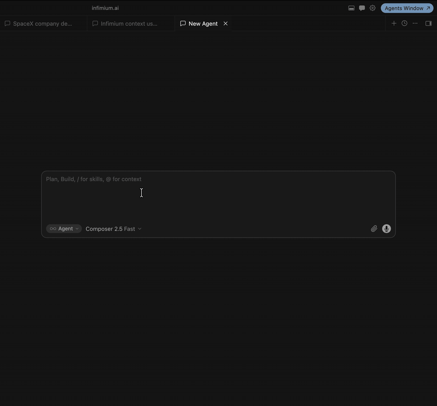
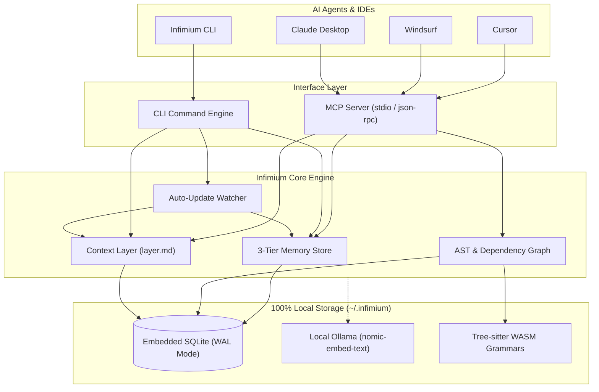

<p align="center">
  
</p>

# Infimium

> **The Private Context Layer & Super Brain for AI Coding Agents.**  
> Persistent episodic memory, deep dependency graphs, and instant AST-compact code context — 100% local, zero cloud dependencies, zero token bloat.

---

[](https://www.npmjs.com/package/infimium)
[](https://lobehub.com/mcp/infimium-ai-infimium-agent)
[](LICENSE)
[](https://github.com/infimium-ai/infimium-agent)

---

## Demo

[](docs/assets/infimium-demo.mp4)

---

## Why Infimium?

Modern AI coding agents face two core problems:
1. **Context Window Exhaustion:** Reading massive files or dumping entire directory structures burns tokens and triggers model amnesia.
2. **Session Amnesia:** Once an agent session ends, the agent loses track of what it built, why decisions were made, and what tasks remain.

Infimium solves both by acting as a **local context and memory layer**:

```text
Without Infimium:
  200,000 lines of code -> Agent dumps entire files -> Context blown + slow & expensive
  grep "price calculation" -> Misses calcPropertyValue() in dependent module
  Session resets -> Agent forgets recent architectural decisions and progress

With Infimium:
  semantic_code_search("price calculation logic")
  -> services/property/calc.ts:142 · calcPropertyValue() (compact signature: ~8 tokens)
  -> Callers: getListingPrice(), estimatePropertyTax()
  -> expand_symbol("calcPropertyValue") loads only the exact function needed (~99.5% token reduction)
  -> infimium resume restores the active task, scratchpad events, and durable ledger rules instantly
```

---

## Architecture Overview



---

## Quick Start (3 Minutes)

### Prerequisites
- **Node.js**: `>= 22.5.0`
- **Ollama** *(Optional, automatically configured)*: For local embeddings (`nomic-embed-text`).

### 1. Initialize in Your Repository

Run setup from the root directory of the project you want to index:

```bash
cd /path/to/your/project
npx infimium@latest setup
```

What `setup` does:
- Creates global configuration at `~/.infimium/.env`.
- Checks/starts Ollama and pulls the fast `nomic-embed-text` embedding model.
- Indexes your project’s code symbols, local docs, and dependencies.
- Runs `doctor` verification checks and launches the local **Playground** UI.

> [!NOTE]
> Run setup inside your project directory, not from your home directory (`~`). Infimium prevents broad home directory indexing automatically.

If you don't have Ollama installed yet, let Infimium install it:
```bash
npx infimium@latest setup --install-deps
```

---

## Connect Your AI Agent

Add Infimium to your IDE or MCP client configuration:

### Cursor, Windsurf, Claude Desktop, & Goose

Add to your `mcpServers` configuration (`mcp_config.json` or Claude Settings):

```json
{
  "mcpServers": {
    "infimium": {
      "command": "npx",
      "args": ["-y", "infimium", "serve"]
    }
  }
}
```

Restart your client. Your agent can now invoke Infimium tools natively:
- *"Use Infimium `get_context` to understand this project before making changes."*
- *"Use Infimium `semantic_code_search` to find authentication logic."*
- *"Use Infimium `dep_graph` to inspect callers of processPayment."*
- *"Use Infimium `infimium_update` to record progress."*

---

## Autonomous Memory & Real-Time Auto-Update

Infimium gives your agent continuous episodic memory that updates while you work.

### Enable Background Auto-Updates

Run the watcher in your project terminal:

```bash
infimium update start --interval 300
```

- **Immediate Startup Check:** Executes an immediate workspace evaluation right upon starting.
- **Understands Workspace Changes:** Inspects git status and file modification times to generate structured change summaries:
  ```text
  [17:05:12] Memory updated: Auto-detected changes in 3 file(s): M lib/auth.ts, A test/auth_test.ts
  [17:10:12] Workspace clean: No new changes detected.
  ```
- **Live Terminal Logging:** Keeps you informed in real-time with timestamped updates.
- **Active Scratchpad Sync:** Updates `project_state.updated_at` and records progress events automatically.

To stop background updates:
```bash
infimium update stop
```

### Manual Memory Checkpoints

Force a memory checkpoint or record specific task notes:

```bash
# Record progress with a note and active task
infimium update refresh --task "Refactor auth" --note "Implemented JWT validation middleware"

# Attach specific files to the checkpoint
infimium update refresh --note "Updated router" --file src/router.ts --file src/auth.ts

# Inspect update configuration and status
infimium update status
```

---

## 3-Tier Project Memory Model

Infimium structures agent memory into three distinct tiers to avoid context blowup:

| Tier | Purpose | Storage & Lifetime |
| :--- | :--- | :--- |
| **Active Scratchpad** | Immediate working memory, active task progress, and live file modifications. | Active session; pruned upon session completion. |
| **Episodic Archive** | Compact summaries of completed tasks, milestones, and blockers. | Long-term SQLite archive. |
| **Semantic Ledger** | Durable project rules, architecture decisions, and conventions across all agents. | Permanent versioned key-value ledger. |

### Recording Decisions & Progress

```bash
# Add a progress note to the active session
infimium remember "Added rate-limit middleware" --type progress --task "Rate limiting"

# Record a durable architecture decision into the semantic ledger
infimium remember "Use Redis-backed counters in production" --type decision

# Check current active memory and recent events
infimium resume
```

### Completing & Compacting a Session

When a task is finished, compact the session scratchpad into a permanent milestone:

```bash
infimium memory complete
```
*(Uses local Ollama compaction if available, with deterministic fallback).*

---

## Token Economics: ~99.5% Initial Token Reduction

Infimium uses an **AST-first retrieval strategy**. Instead of feeding full function bodies into the agent context, semantic code search returns lightweight AST symbol signatures:

```text
Full implementation payload:  ~1,460 tokens
AST signature skeleton:            ~8 tokens
Initial payload reduction:       ~99.5%
```

Agents browse compact signatures first and request full bodies on-demand via `expand_symbol`.

Explore token savings in your repository with the local UI:
```bash
infimium playground
```
Navigate to **Token Economics** to see actual token differentials calculated across your codebase.

---

## CLI Command Reference

| Command | Usage | Description |
| :--- | :--- | :--- |
| `setup` | `infimium setup [--install-deps]` | Interactive setup (Ollama, models, SQLite, indexer). |
| `doctor` | `infimium doctor` | Runs health checks on Ollama, models, parsers, and SQLite. |
| `status` | `infimium status` | Displays indexed files, symbol counts, and memory state. |
| `index` | `infimium index [--verbose]` | Scans and indexes the repository or multi-project workspace. |
| `watch` | `infimium watch` | Continuous file indexer daemon. |
| `update` | `infimium update [refresh\|start\|stop\|status]` | Records memory checkpoints or runs periodic auto-updates. |
| `remember` | `infimium remember "<note>" [--type <t>] [--task <t>]` | Adds a progress note, decision, or milestone to memory. |
| `resume` | `infimium resume` | Displays active task, last update time, and scratchpad events. |
| `memory` | `infimium memory [complete\|search\|ledger]` | Compacts sessions, searches ledger, or inspects durable rules. |
| `get-context` | `infimium get-context [--refresh]` | Outputs the complete tri-zonal context layer (`layer.md`). |
| `code-search` | `infimium code-search "<query>"` | Semantically searches code and returns symbol signatures. |
| `expand-symbol` | `infimium expand-symbol "<symbol>"` | Retrieves the full implementation for an indexed symbol. |
| `dep-graph` | `infimium dep-graph "<symbol>"` | Displays callers, callees, imports, and HTTP routes. |
| `docs-search` | `infimium docs-search "<query>"` | Semantically searches local documentation (md, txt, pdf, html). |
| `plan` | `infimium plan "<task>" [--dry-run]` | Generates an implementation plan grounded in repository context. |
| `playground` | `infimium playground` | Launches the local interactive web dashboard. |
| `workspace` | `infimium workspace` | Manages federated multi-project workspaces. |
| `telemetry` | `infimium telemetry [on\|off]` | Enables or disables anonymous privacy-safe lifecycle telemetry. |

---

## MCP Tools Reference

When Infimium runs as an MCP server (`infimium serve`), it provides these 12 tools to AI agents:

| MCP Tool | Primary Use Case | Key Arguments |
| :--- | :--- | :--- |
| `hello_infimium` | Confirms MCP server connectivity and status. | None |
| `get_context` | Retrieves repository context, active memory, and handoff graph. | `refresh` (boolean), `project_path` (string) |
| `infimium_update` | Refreshes episodic memory, logs notes, or configures auto-updates. | `action` (`refresh`\|`start`\|`stop`\|`status`), `note`, `task`, `handoff`, `files` |
| `semantic_code_search` | Finds code symbols by natural language meaning. | `query` (string), `limit` (number) |
| `expand_symbol` | Fetches full source implementation for a given symbol. | `symbol_name` (string), `file_path` (string) |
| `dep_graph` | Inspects callers, callees, imports, and API routes. | `symbol_name` (string) |
| `query_local_docs` | Searches Markdown, text, HTML, and PDF documentation. | `query` (string) |
| `project_memory` | Manages active scratchpads, completes sessions, or queries ledger. | `action` (`resume`\|`remember`\|`complete`\|`search`\|`ledger`), `summary`, `task` |
| `plan` | Generates a verified implementation plan for a task. | `task` (string), `dry_run` (boolean) |
| `web_search` | Performs external web searches *(optional, requires Tinyfish API key)*. | `query` (string) |
| `fetch_url` | Converts web pages to clean Markdown context. | `url` (string) |
| `shell` | Executes sandboxed, allowlisted terminal commands with timeouts. | `command` (string), `args` (array) |

---

## Multi-Project Workspaces

If your repository contains multiple packages (e.g. monorepo with frontend, backend, and shared libraries):

```bash
infimium index
```

Infimium automatically discovers sub-projects by scanning for `package.json`, `pubspec.yaml`, `Cargo.toml`, and `go.mod`. It creates `infimium.workspace.json` and federates cross-project dependency graphs while isolating memory per project.

For non-interactive CI setup:
```bash
infimium index --yes --no-playground
```

---

## Local Architecture & Supported Languages

- **Embedded SQLite:** Fast local database running in WAL mode for vectors, graphs, checkpoints, and memory. Zero Docker or external database services required.
- **Tree-sitter AST Extraction:** Native and WASM parsers extract symbols, signatures, docstrings, imports, and call sites.
- **Supported Languages:**
  - **Bundled:** TypeScript, JavaScript, Python, Dart.
  - **Dynamic WASM:** Go, Rust, Java, Ruby, PHP, C#.
- **Boundary-Aware Chunking:** Documentation indexing respects Markdown headings, code blocks, and paragraph boundaries.
- **Ignore Rules:** Honors `.gitignore`, `.infimiumignore`, and built-in rules (excluding `node_modules`, build outputs, binaries, and caches).

---

## Privacy Guarantee

Infimium is designed for maximum privacy:
- **100% Local:** Source code, documentation, embeddings, dependency graphs, memory notes, and queries never leave your local machine.
- **Optional Anonymous Telemetry:** Anonymous lifecycle telemetry (`setup_completed`, `doctor_run`) helps improve installation reliability. It contains **no code, no paths, no prompts, and no identifiers**.
  
Disable anytime:
```bash
infimium telemetry off
```
or in your environment:
```env
INFIMIUM_TELEMETRY=false
```

---

## Troubleshooting

### Database is locked (`Failed to start Infimium: Database is locked`)
Another Infimium process (e.g., `infimium watch` or `infimium playground`) is currently accessing the database. Stop the running process with `Ctrl+C` before running manual index migrations.

### Health Check Diagnostic
If any tool or index behavior seems unexpected, run:
```bash
infimium doctor
```
Every failed check outputs an exact copy-paste command to fix the issue.

---

## License & Contributing

Infimium is open source under the [MIT License](LICENSE). Contributions, bug reports, and pull requests are warmly welcomed via [GitHub](https://github.com/infimium-ai/infimium-agent).
